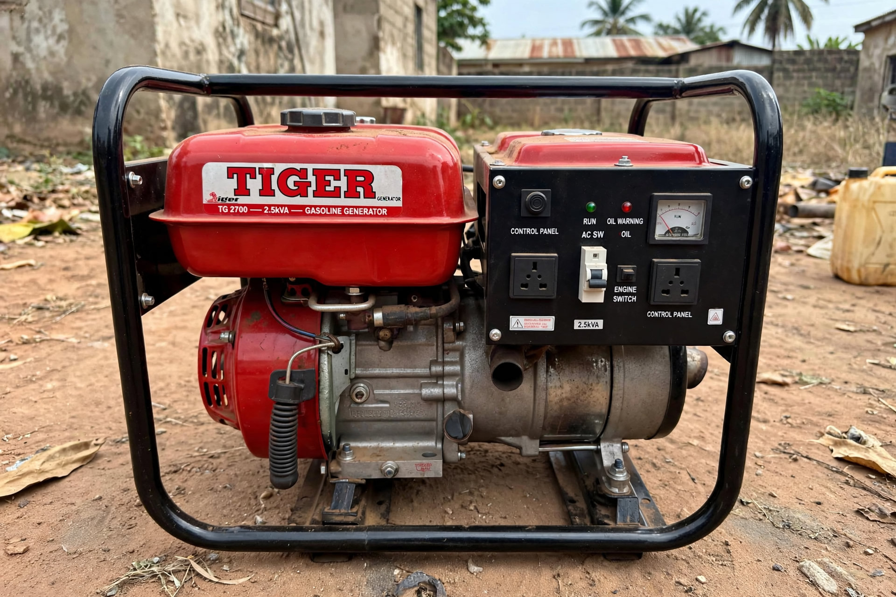

<div align="center">
  
  <h1>FixAm — Snap it, fix am</h1>
  <p><strong>AI repair guide for the machines Nigeria runs on.</strong><br />
  Photograph the fault, describe it in English or Pidgin, get the failing parts<br />
  drawn on your photo plus steps, fair Naira prices, and safety warnings.</p>
  <p>
    <a href="https://fixam-iota.vercel.app/"><strong>🌐 Live demo</strong></a> ·
    <a href="https://fixam-iota.vercel.app/app?demo=1"><strong>▶ 20-second auto demo</strong></a> ·
    <a href="https://fixam-iota.vercel.app/api/health"><strong>🩺 Health / live-vs-mock</strong></a> ·
    <a href="https://github.com/nimrid/FixAm">Code</a>
  </p>
  <p><em>Indie entry · Meta Global AI Developer Hackathon · Build for Your World</em></p>
</div>

---

## Status

| Check | Result |
|---|---|
| Stack | Next.js 16.4.3 · React 19.3 · Node ≥ 20.9 (3 dependencies, zero UI frameworks) |
| `npm test` | 13/13 pass (`node --test`, no test framework dependency) |
| `npm run build` | Clean (Turbopack), 12 routes |
| Models | Muse Spark 1.3 · SAM 3.1 (+ video) · Muse Image 1.0 · Voice Transcribe 1.0 · Files API |
| Compute | Modal CPU pipeline, deployed and smoke-tested (see [Deploy](#deploy)) |

## Judge this in 2 minutes

1. **Auto demo (20s):** open [/app?demo=1](https://fixam-iota.vercel.app/app?demo=1). A real Tiger-generator photo is segmented, then diagnosed. If any model call fails, the result is explicitly badged `offline demo` — never presented as live AI.
2. **Live check:** open [/api/health](https://fixam-iota.vercel.app/api/health). It reports `status` (`demo` | `configured` | `missing_key`), which key env var is set, model IDs, and Modal hosts. It prints no secrets and calls no models (zero spend).
3. **Full flow:** open [/app](https://fixam-iota.vercel.app/app), pick a domain (gen/okada/solar/phone/car), snap a photo, and describe the fault by typing or by Pidgin voice note. Watch for: boxes + confidence on the photo, verdict with steps/tools/warnings, Naira parts list, rewinder-vs-DIY savings, WhatsApp share, repair diagram.
4. **Motion:** on gen/okada/car, record a 3-second clip at idle. The Modal job tracks the domain's engine + exhaust with SAM 3.1 video, Spark judges shake + smoke, and the report names the tracked subject.

## The problem

When a generator dies at night, an okada won't start, or a car overheats on the express, most Nigerians can't tell what's wrong — and finding an honest mechanic or rewinder is stressful, expensive, and at night, unsafe. Repair knowledge lives in people's heads; FixAm puts it in your pocket, in your language.

## What it does

Pick what broke — **generator, okada, solar, phone, or car** — snap a photo, say what's wrong (typed or Pidgin voice note), and FixAm:

1. **Finds the parts** — Spark first reads your symptom and decides *which* parts to look for (agentic routing, per-domain vocabularies in `lib/domains.js`); SAM 3.1 then segments each concept and draws labeled boxes + confidence on your photo. Route: `POST /api/segment`.
2. **Diagnoses with vision** — Spark reads photo + symptom + parts and returns strict-schema JSON: bilingual verdict, confidence, numbered steps, tools, needed parts, warnings. Community medians ground the price estimate. Route: `POST /api/diagnose`.
3. **Prices it fairly** — every fix carries Naira parts prices (Ladipo/Computer Village book), a shop/mechanic estimate, DIY savings, a one-tap WhatsApp share, and a domain-aware AI repair diagram (`POST /api/diagram`).
4. **Checks motion** — a Modal pipeline tracks the domain's subject (`engine` / `motorcycle engine` / `car engine`, falling back to the whole unit when the engine isn't visible) plus `exhaust pipe` frame-by-frame, computes a vibration index, and Spark judges shake + exhaust smoke with do-not-ride/drive safety rules. Async submit → poll, so Vercel Hobby's 60s cap can never force a mock.
5. **Learns prices** — users can report what they actually paid; medians appear once 3+ reports exist (`POST /api/report-price`, `GET /api/community-prices`). Cold starts serve honestly labeled book seeds (`source:"book"`, never shown as community).

Real output, Tiger 2.5kVA (boxes + verdict from the live API):



## Meta technology — where to look

| Model / API | Where it works | Prove it |
|---|---|---|
| Muse Spark 1.3 | Vision diagnosis (strict JSON schema), agentic concept router, motion verdict, Spark-grounded community prices | `lib/meta.js` → `callSparkDiagnosis`, `callSparkConcepts`, `callSparkMotion`; prompts in `lib/prompts.js` |
| SAM 3.1 | Per-concept streaming segmentation, boxes + confidence overlaid | `lib/meta.js` → `callSAMParts`, `parseSamLine` |
| SAM 3.1 video | Per-domain subject + exhaust tracking on 3s clips, with whole-unit fallback | `modal_app.py` → `MOTION_TRACKS`, `_track_subject`, `_sam_video_track` |
| Muse Image 1.0 | Domain-aware repair diagrams; output format detected from bytes (it returns WebP) | `callImageGen`, `imageMimeFromB64`, `lib/diagram-prompt.js` |
| Voice Transcribe 1.0 | Pidgin/English voice notes; browser converts to 16kHz mono WAV via Web Audio first | `callTranscribe`, `/api/transcribe` |
| Files API | Clip upload for video segmentation (`purpose=user_data`) | `modal_app.py` upload step in `_run_analysis` |

## Domains

| | Domain | Covers | Motion |
|---|---|---|---|
| ⚡ | Generator | Tiger, Elepaq, Firman: hard-start, smoke, no-output | ✅ engine + exhaust |
| 🏍 | Okada | Bajaj Boxer, Honda CG: starting, chain, brakes, oil | ✅ engine + exhaust (idle only) |
| ☀ | Solar | Inverter faults, weak charging, battery care | — (no moving parts to track) |
| 📱 | Phone | Battery, charging, cracked screen, storage, network | — |
| 🚗 | Car | Roadside overheating, no-start, brakes, flats — night-safety rules | ✅ engine + exhaust (parked idle) |

Adding a domain = `lib/domains/<id>/{faults.json,prices.json}` + one registry entry in `lib/domains.js` + one picker button. Tracked motion concepts live in `lib/motion.js` (JS) and `MOTION_TRACKS` (`modal_app.py`) — a test pins them in sync.

## API surface

All routes enforce byte caps and per-IP rate limits (`lib/limits.js`); failures return explicit fallback JSON (`fallback:true`, `fallback_reason`) instead of silently serving mocks. Request too large → `413`. Over the rate limit → `429` with `Retry-After`.

| Route | Method | Purpose |
|---|---|---|
| `/api/segment` | POST | Parts on photo (agentic when symptom present) |
| `/api/diagnose` | POST | Vision diagnosis + priced parts |
| `/api/diagram` | POST | Domain-aware repair diagram (55s cap, Vercel-safe) |
| `/api/transcribe` | POST | Voice note → text |
| `/api/analyze-video` + `/api/motion-status` | POST + GET | Async motion submit → poll |
| `/api/community-prices` + `/api/report-price` | GET + POST | Median prices + user corrections |
| `/api/health` | GET | Config snapshot: demo vs live, model IDs, Modal hosts (no secrets, no model calls) |

## Run locally

```bash
cd FixAm
cp .env.example .env   # add MODEL_API_KEY (hackathon credits)
npm install            # Node ≥ 20.9
npm run dev -- -H 0.0.0.0 -p 3000
npm test               # 12 regression tests
```

Open `http://<your-lan-ip>:3000` on your phone (same WiFi). Mic/camera **recording** needs HTTPS — use the Vercel URL above or `cloudflared tunnel --url http://localhost:3000`; photo capture + typing work over plain HTTP.

`FIXAM_DEMO_MODE=true` runs fully offline with local mocks (zero API spend). Same-named key must be set in Vercel.

## Deploy

**App (Vercel):** `npx vercel`, then add the `.env` values in the dashboard (Project → Settings → Environment Variables). Motion is async (submit → poll) specifically to survive Hobby's 60s cap.

**Video pipeline (Modal):**

```bash
pip install modal
export MODAL_TOKEN_ID=... MODAL_TOKEN_SECRET=...   # hackathon partner creds
export FIXAM_MODAL_SECRET=$(openssl rand -hex 24)  # must match .env
modal deploy modal_app.py   # paste ANY endpoint URL into MODAL_VIDEO_URL
```

Sibling endpoints (`submit-clip`, `clip-result`, `report-price`, `community-prices`) are derived by swapping the function slug — or set per-endpoint `MODAL_*_URL` vars explicitly. Redeploy Modal after any `modal_app.py` change. Smoke-test: `community-prices` with a wrong secret must return `unauthorized`, and `submit-clip` with `domain:"solar"` must return a domain error.

## Project structure

```
app/            landing (/) + tool (/app) + 9 API routes
lib/            Meta client, domain registry, prompts, community merge,
                rate limits, motion/diagram config, health snapshot, mocks
lib/domains/    per-domain faults, Naira prices, SAM vocabularies, aliases
modal_app.py    video pipeline: ffmpeg → Files API → SAM tracking → metrics;
                Dict-backed community price store
tests/          13 regression tests (node:test, no framework)
public/         PWA icons, manifest, service worker, demo photo
```

## Honest limits

- **Offline is shell-level, not full** — the service worker (`public/sw.js`) precaches the app shell, serves cached GETs, and shows an offline page for navigations; live AI diagnosis (POST) still needs a connection.
- **Rate limiter is per serverless instance** — an abuse brake, not a distributed quota.
- **Community prices are cold** — no real reports yet; until 3+ exist per part, the book prices you see are labeled as the book.
- **30 guided faults** (6/domain) — Spark can reason beyond them, but field validation against real shops hasn't happened yet.

## Roadmap

- Field validation: real-shop accuracy checks per domain, Pidgin voice eval
- More domains (fans, pumps) via the registry; follow-up questions that refine a diagnosis conversationally

---

Built solo in Nigeria with Next.js, Meta Model API, and Modal.
